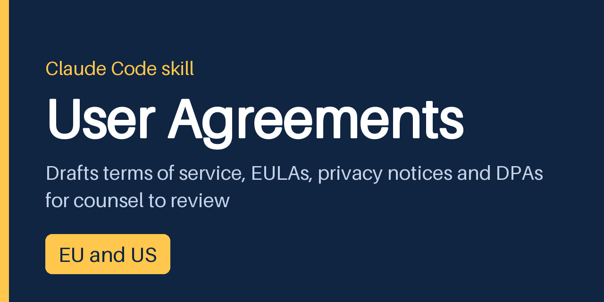

# User Agreements Skill



A skill for Claude Code that drafts terms of service, EULAs, subscription terms, privacy and cookie notices,
acceptable use policies and B2B data processing agreements for software and connected products sold in the EU and
the US. It hands the drafts to your lawyer with the legal basis of every clause, the open points and a list of what
your product flows must do. Documentation: <https://nghorbani.github.io/user-agreements-skill/>

The drafts are for review by a qualified lawyer and are not legal advice. Law as of 20 October 2026.

## How to use it

1. Install the skill (below) and restart Claude Code.
2. Describe your business and product in a normal message: who sells, what, to whom, in which countries, how people
   pay and which data you collect. Say which documents you want.
3. Answer the questions the skill asks back. It asks only for the facts your message left out. If you want drafts
   right away, say so: it drafts on stated assumptions and marks what each missing answer would change.
4. Send the hand-over to your lawyer.

## What to expect

You get a folder of Markdown files:

| File | Contents |
|---|---|
| the drafts | one common text with marked modules for EU consumers, EU business customers and the US, or separate versions where the rules cannot share one text; statutory labels and model forms word for word |
| `annotations.md` | the statute, regulation or judgment behind each clause; a table of every law considered (applies, does not apply, undetermined); a checklist table with every item met, not applicable or open |
| `open-points.md` | missing facts, national rules to verify, rules that take effect later, choices for your lawyer |
| `implementation-requirements.md` | what checkout, renewal, cancellation, consent and moderation flows must do, with owner and evidence columns |

The skill does not decide facts it was not given. Where a law turns on a number you did not provide, such as revenue
or users per US state, that law stays undetermined and the clauses that depend on it go to the open points.

## Examples

Four complete hand-overs, each from a single request (fictional companies):

- [Fitness app with a monthly subscription](https://nghorbani.github.io/user-agreements-skill/examples/fitness-app/)
  in Germany, Austria, California and New York: subscription terms, withdrawal information, checkout and
  cancellation requirements.
- [B2B SaaS for manufacturers](https://nghorbani.github.io/user-agreements-skill/examples/b2b-saas/) in the EU and
  three US states: master subscription terms and a data processing agreement.
- [Connected camera with a desktop app](https://nghorbani.github.io/user-agreements-skill/examples/camera-eula/):
  EULA for the app and firmware, cloud plan terms and a privacy notice for diagnostic data.
- [Photo community with user content](https://nghorbani.github.io/user-agreements-skill/examples/ugc-platform/):
  platform terms, moderation policy and notice and complaint flows under the Digital Services Act.

A first message can be as short as this:

```text
We are Example Fitness GmbH in Ulm. We sell a fitness app with a monthly subscription and a 7-day free trial
to consumers in Germany, Austria, California and New York. Please draft our subscription terms and the
withdrawal information, and tell us what our checkout and cancellation flows must do.
```

## Install

As a Claude Code plugin, in PowerShell, bash or zsh:

```
claude plugin marketplace add nghorbani/user-agreements-skill
claude plugin install user-agreements@user-agreements-skill
```

With the `skills` command line tool (needs Node.js):

```
npx skills add nghorbani/user-agreements-skill -a claude-code
```

Or copy the folder `plugins/user-agreements/skills/user-agreements` into your skills folder.

PowerShell:

```powershell
git clone https://github.com/nghorbani/user-agreements-skill.git
New-Item -ItemType Directory -Force "$env:USERPROFILE\.claude\skills" | Out-Null
Copy-Item -Recurse user-agreements-skill\plugins\user-agreements\skills\user-agreements "$env:USERPROFILE\.claude\skills\user-agreements"
```

bash:

```bash
git clone https://github.com/nghorbani/user-agreements-skill.git
mkdir -p ~/.claude/skills
cp -r user-agreements-skill/plugins/user-agreements/skills/user-agreements ~/.claude/skills/
```

The skill is Markdown only: no scripts, no network calls. More in the
[install guide](https://nghorbani.github.io/user-agreements-skill/install/).

## Coverage

Germany is the reference EU member state, with the EU directives and regulations behind it. In the US the skill
covers federal law, California and New York in full, and the other state privacy laws as a matrix of flags.

| Topic | EU law | Germany | US federal | California | New York | Other US states |
|---|---|---|---|---|---|---|
| Formation and assent | covered | covered | covered | covered | not covered | not covered |
| Standard terms control | covered | covered | flag | covered | not covered | not covered |
| Withdrawal and cancellation | covered | covered | not covered | flag | flag | not covered |
| Auto-renewal | covered | covered | covered | covered | covered | flag |
| Warranties and conformity | covered | covered | covered | not covered | not covered | not covered |
| Liability | covered | covered | flag | covered | not covered | not covered |
| Licensing and EULA | covered | covered | covered | not covered | not covered | not covered |
| Privacy notice | covered | covered | flag | covered | not covered | covered |
| Cookies and tracking | covered | covered | flag | covered | not covered | flag |
| Children | covered | flag | covered | not covered | not covered | not covered |
| Platform and user content | covered | not covered | covered | not covered | not covered | not covered |
| Dispute resolution | covered | covered | covered | covered | not covered | not covered |
| Choice of law | covered | covered | flag | not covered | not covered | not covered |

Flag means the skill raises the topic as an open point or covers only part of it. Germany applies the EU regulations
directly, so "not covered" there means no extra German statute on top of the EU rule. The full instrument list is on
the [coverage page](https://nghorbani.github.io/user-agreements-skill/coverage/).

**EU:** Consumer Rights Directive with the withdrawal function and the 2024/825 duties, Unfair Contract Terms
Directive, Unfair Commercial Practices Directive, Digital Content and Sale of Goods Directives, right to repair
Directive, e-Commerce Directive, GDPR with the standard contractual clauses, ePrivacy Directive, Digital Services Act,
P2B Regulation, Data Act, AI Act transparency duties, Software Directive, Geo-blocking Regulation, Product Liability
Directive, Rome I and Brussels Ia.

**Germany:** BGB standard terms, distance selling, digital products, withdrawal and sale of goods; EGBGB information
duties and model forms; DDG Impressum; TDDDG cookie consent; UrhG software chapter; VSBG; BDSG.

**US federal:** FTC Act section 5, ROSCA and the Negative Option Rule status, ESIGN and online assent cases, Federal
Arbitration Act, Magnuson-Moss, COPPA, Section 230, 17 U.S.C. §§ 117 and 512, CAN-SPAM.

**US states:** California Automatic Renewal Law, CCPA and regulations, CalOPPA, Civil Code §§ 1668, 1670.5, 1751;
New York GBL §§ 527 and 527-a; Virginia, Colorado, Connecticut and Texas privacy acts; Illinois BIPA; Washington My
Health My Data Act; a matrix of the other state privacy laws.

### Not covered

National law of EU member states other than Germany beyond the EU directives and regulations (drafted at directive
level, with the national rules as open points); UK law; US states outside the matrix; sector rules such as HIPAA,
GLBA, PCI DSS or financial services law; employment, tax and export control.

## Disclaimer

The skill writes drafts for review by a qualified lawyer. They are not legal advice, and using the skill creates no
lawyer and client relationship. The references follow the law as of 20 October 2026; check what changed since then
before relying on a draft. The skill covers only the jurisdictions and topics listed above. Provided "as is" under
the Apache License 2.0, without warranties or conditions of any kind.

## Attribution

EU legal texts: © European Union, <https://eur-lex.europa.eu>; reused under the Commission's reuse policy. European
Commission guidance and EDPB documents are cited with acknowledgment of their source. German federal statutes are
official works under § 5 UrhG, and US federal and state statutes and regulations are not subject to copyright.

## License

Apache License 2.0. See [LICENSE](LICENSE).
